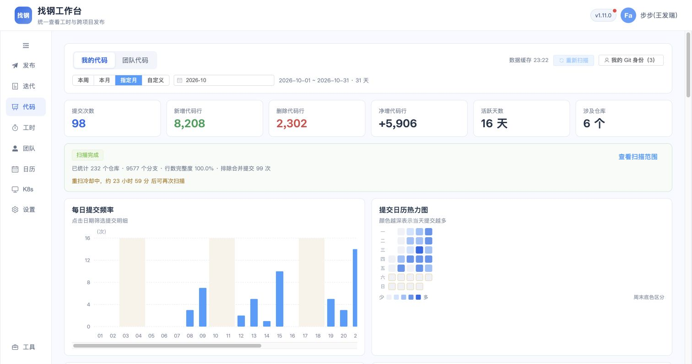

# Git 身份优先统计实施与本地验收（2026-11-02）

状态：代码实施、自动检查和本人十月真实验收完成；团队真实多成员 PAT 验收未执行。未提交、推送或发布。

## 已实现规则

- 成员身份统一存于 SELF，个人及所在团队使用相同身份集合；团队成员身份只读，由成员从“我的 Git 身份”维护。
- 每位成员本人 PAT 的 Name/Email 初始化 DEFAULT 身份，已有相同身份不覆盖；默认身份和手动身份均可删除。删除使用 ignored + DELETED 墓碑，默认初始化 INSERT IGNORE 不复活同一身份；显式重新添加可恢复。
- 邮箱或作者名任一有效身份命中即可；同仓库/SHA 多分支去重。同一提交命中同一成员多个身份只计一次；跨成员身份歧义不重复归属，重复身份键进入 coverage.identityConflictCount。
- 每页元数据返回后先筛身份，只把命中提交写入 MySQL 和 Redis 分支快照。合并提交只在命中身份后保存，用于排除数，仍不计本人提交次数或行数。
- 分支缓存 v2 使用成员身份集合指纹，扫描任务表 identity_signature 持久记录读取口径。身份变更或旧任务没有指纹时，全量重取查询月份，不被旧口径的历史月冷却阻挡；活动任务仍去重。扫描过程中身份变更则停止旧口径任务，后续请求重读。
- 团队按成员并发发现仓库，公共仓库只读取一份分页，分支读取保留最多四路及 PAT/全局限流。单成员发现失败保留其他成功范围。
- 个人页整段“扫描范围内尚有 X 次提交未归属作者”提示及绑定引导已移除。团队不再展示全作者未归属入口/KPI；保留成员身份查看及本人身份增删。
- online.base.apijar.service 的非合并提交继续仅计次数，SKIPPED_REPOSITORY，增删行及文件数为 NULL，不取 diff。

## 数据迁移与回退材料

确认仅连接本地 127.0.0.1:3306/iw_mixes，迁移前活动代码扫描任务为 0。四张功能表一致性备份 `/private/tmp/iw-identity-first-before-huuwcyga.sql`，权限 0600；没有备份凭证表。

执行新增迁移 iw-external-migrate-20261102-identity-first.sql，增加任务身份指纹列并把旧团队身份导入对应 SELF，相同个人配置优先，不覆盖忽略/删除。迁移重复执行通过；迁移后 SELF 身份 7 条，本人 PAT 默认姓名随后初始化/复用，保留原有邮箱及作者名。

旧分支/月 v1 全作者缓存 26867 个键已备份到 `/private/tmp/iw-identity-first-old-snapshots-7honaxnj.json`（0600）并定向删除，仅匹配 zhaogang:code:v1:branch-month:v1:*，未 FLUSH 或删除凭证/其他业务缓存。

首次扫描只清理本范围月份内不匹配当前身份的旧记录。旧团队十一月 106 条记录经当前团队成员表只读对照与 canonical SELF 身份匹配，保留命中 5 条、清理未命中 101 条；只写功能提交表，未修改成员关系或其他业务表。

## 自动检查

- 固定 Maven 3.8.6、Java 17、显式 /usr/local/maven/repository、独立最小 settings 执行完整 iw-external reactor test：297 tests，0 failures/errors/skipped。日志 `/private/tmp/iw-identity-first-final-test.log`。
- Web type-check、build、check:zhaogang-release-notes、test:zhaogang-code-stats-range 均退出 0。构建仅既有 eval、chunk 大小及 NODE_ENV 提示。
- 新增/调整回归覆盖默认双身份、默认身份删除不复活、邮箱/作者名 OR、跨成员歧义、个人与团队共用身份、他人不能修改身份、过滤前的 MySQL/Redis 写入保护、缓存指纹变化、读取中变更身份、历史月重读及活动去重、双成员并发、共享仓库只读一次和单成员失败保留成功结果。

## 真实链路结果

复用浏览器绑定的本人只读 PAT，未使用其他成员或生产 PAT。页面已实际观察到 3 个本人身份：PAT 默认姓名、原邮箱、原作者名；默认姓名及邮箱均提供删除操作。本人十月原有 98 次提交、16 个活跃日、6 个仓库及新增 8208/删除 2302 行仍保留。本人匹配的合并记录 99 条，原全作者合并数 2023 不再作为个人排除数。

页面初次默认打开十一月，自动创建任务 20；为集中验收十月，已定向取消本轮自动发起的该任务并保留成功记录。十月任务 21 按新口径重建缓存：17:10:30—17:24:37，847 秒，232 仓库/9574 分支/197 个命中仓库-SHA 键。该轮为 PARTIAL，仓库/diff 失败均为 0、未截断；由工作线程覆盖不完整标记触发，具体分支头复核原因未持久化，不把这一轮标记为完整通过。

最终版本 23:19 启动后，通过真实页面新增临时邮箱身份，再删除。真实 UI 操作成功，删除后列表恢复 3 个本人身份；测试身份在数据库为 DELETED/ignored，确认不会参与匹配。任务 22 在身份发生变化后以 IDENTITY_CHANGED 停止，未写入提交；恢复原身份集合后自动创建任务 23。

任务 23：23:21:13—23:22:08，55 秒，COMPLETED/DONE，232 仓库、9577 分支、197 个命中仓库-SHA 键、仓库/diff 失败均 0。日志记录复用分支 9555、新读 head 22、提交分页适配器调用 53；该数字不包含目录、内部重试等全部 HTTP 请求，不能解释为总请求次数。冷扫描相同计数为 9037 次分页调用。期间上游新增 3 个真实分支，目录数变化属实。

最终 SQL 对账：本人十月普通提交 98、活跃日 16、仓库 6、新增 8208、删除 2302；合并提交排除 99。状态为 OK 89、SKIPPED_REPOSITORY 9、SKIPPED_MERGE 99；不再保存此前 2413 条其他作者的普通提交。个人所有月份不匹配有效身份的提交行数为 0。专项仓库 9 次本人普通提交保留，行数/文件数非 NULL 的异常记录为 0。

Redis 实际遍历验收：v2 快照 10512 个，跨快照包含 1135 条提交记录（同一 SHA 可在多个快照中出现），未匹配当前身份的记录 0，旧 v1 快照残留 0。未把不同快照的记录累加为业务提交次数。

## 本轮 AC 与运行版本

| 编号 | 结论 | 真实证据与边界 |
| --- | --- | --- |
| ID-01 默认双身份 | 通过 | 真实页面在原邮箱、作者名之外补充 PAT 默认姓名；本人 3 个身份。单测验证全新成员恰为两个默认身份。 |
| ID-02 新增/删除与不复活 | 通过 | UI 新增及删除临时身份成功；默认身份删除不复活由生命周期单测覆盖，未删除用户真实默认身份。 |
| ID-03 过滤后才持久化 | 通过 | 最终 MySQL 未匹配行 0；遍历 Redis v2 未匹配行 0；旧全作者快照清理有备份。 |
| ID-04 身份变更重读历史月 | 通过 | 任务 22 因身份变更停止；旧口径冷却未阻断自动创建 23，最终完成。 |
| ID-05 个人/团队共用与冲突 | 自动测试通过；真实多人未执行 | 共享 SELF、成员删除同步、跨成员歧义和越权均有回归；未使用其他成员 PAT 做真实扫描。 |
| ID-06 成员并发与共享去重 | 自动测试通过；真实多人未执行 | 双成员并发屏障验证、共享仓库只读一次、单成员失败保留数据。 |
| ID-07 页面提示与真实统计 | 通过 | 最终页面扫描完成，98 次/8208 新增/2302 删除，整段未归属提示不存在；截图为真实绑定态。 |
| ID-08 特殊仓库与合并规则 | 通过 | 普通提交 9 条 SKIPPED_REPOSITORY，行数/文件数均 NULL；已匹配合并 99 条不计入 98 次。 |
| ID-09 自动检查 | 通过 | 后端 297 tests、Web 四项及两个仓库 diff --check 通过。 |

后端 HEAD：0d6d30194373e3df4ce7b1a9bac6b3430e33a3a3；Web HEAD：d821532cfc9209085e6436093f52df5c9764547f。都包含此前及本轮未提交代码，HEAD 不代表运行的完整改动。

真实版本：Java 17.0.9（JetBrains）、Maven 3.8.6（固定二进制及 /usr/local/maven/repository）、Node v18.17.0、npm 9.8.1、Vite 5.4.21。最终 iw-external-0.2.1.jar 时间 2026-11-02 23:19:45 +0800；通过 local-backend.sh 启动 core PID 49856/18000、external PID 50026/18006；Vite 5173 保持运行，浏览器保留十月页。曾因自动审批额度未完成而未执行的启动命令，在用户回复“继续”后重试成功，没有绕过脚本。

## 文件范围

后端主源码：CodeIdentityDefaults.java（新增）、CodeIdentityResolver.java、CodeIdentityService.java、DefaultCodeStatsModule.java、CodeScanWorker.java、CodeScanService.java、CodeStatsQueryService.java、entity/CodeStatsEntities.java；Mapper 的 ZhaogangCodeIdentityMapper、ZhaogangCodeCommitMapper、ZhaogangCodeScanJobMapper。初始化/原迁移 SQL 同步列定义，新增专项迁移 SQL。

测试：CodeIdentityLifecycleTest、CodeScanIdentityRefreshTest、CodeScanTeamDiscoveryTest 新增；CodeIdentityResolverTest、CodeStatsQueryServiceTest、CodeScanWorkerBranchCacheTest、CodeScanWorkerPartialTest 更新。

Web：src/views/zhaogang/code/ZhaogangCodeMineView.vue、ZhaogangCodeTeamView.vue、components/CodeIdentityDialog.vue、src/types/zhaogangCodeStats.ts。

## 限制与数据残留

团队真实多成员 PAT 联合扫描、跨团队权限及未绑定成员场景未执行，不以夹具通过代替真实验收。保留本次真实用户统计、规范化身份、任务和新快照；单测仅使用 HTTP/内存 fixture，没有数据库合成提交。UI 创建的临时身份 1025 及其删除墓碑已精确清理，临时身份残留 0。专用身份变更测试任务 22 与仓库检查点已备份到 `/private/tmp/iw-identity-first-test-job-22-x0znosyp.sql`（0600）并清理，任务写入提交 0。保留任务 20（本轮自动十一月扫描取消）、21（十月冷扫描）和 23（十月最终成功）供追溯，保留当前有效真实身份及用户命中数据。备份保留供回退，不直接用旧全作者数据覆盖新结果。
