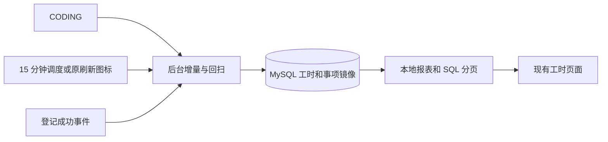

# Dev Hub 工时落库与增量同步设计及实施

日期：2026-11-20。主仓库：`iw-mixes-server`；影响 Web，不涉及小程序。

设计状态：用户已确认并要求开始实施。实施状态：代码与可执行隔离自验已完成，真实 CODING 与生产验证边界见验收记录。用户已在本轮末尾授权提交并推送；生产迁移由用户手动完成，Web 2.2.0 发布仍由用户安排。

## 1. 已确认规则与授权

本次聊天先确认每 15 分钟增量同步，随后确认保留原圆形刷新按钮、原“同步时间”和布局；同步成功后原位更新时间。无新增记录的成功扫描也更新时间，失败与普通查库不推进。

团队工时统一使用成员本人的个人 PAT；仅未绑定时固定使用一个关联团队管理令牌作为统一来源。个人 PAT 失效或权限不足不自动切换；个人 PAT 可读项目较少时也不使用管理令牌补集。邀请加入与手动添加成员遵循相同规则，始终传目标成员 codingUserId。原代码统计与群通知的选择规则不在本次变更范围。

用户明确指令：“确认，开始实施”，随后要求首次只采集北京时间 2026-01-01 00:00 至今、从近到远分页，并要求同一成员 ID 跨团队只同步一次。据此实施后端、Web 和必要迁移脚本，并在本地隔离环境自验；此前草案的“仅设计”限制不再适用。实施时没有生产数据库写入、出站通知、提交、推送、发布授权；后续用户已明确授权提交及推送，不包含新的生产部署或数据库写入。

## 2. 最终链路和交互

打开或切换日期只读库，首次没有镜像时提交后台初始化并明确提示，不能假装 0h。初始化范围为北京时间 2026-01-01 00:00 起至任务执行时刻的提交/创建记录，先本月，再逐月倒序至起点；每段最多 100 页、每页 1000 条，段内两次分页稳定后独立发布。history_before 保存未完成历史上界，失败保留已发布月份，重试未完成段。所有成员近期数据优先于历史补齐，部分可见期间提示不完整，不据此判断缺勤；不执行自动历史清理。

点击原刷新图标快速返回同步状态，按钮 loading，保留现有数据。每段完成即更新图表及已展示明细，近期增量成功更新原同步时间，历史补齐本身不冒充增量；后台自动完成也会更新。运行时 2 秒、空闲时 15 秒轮询，切换范围和卸载会取消旧请求。失败提示沿用现有区域，全部成员不可用时不显示虚假 0h。

时区沿用北京时间。个人同步时间是成功增量完成时间；团队只有当前成员均完成且没有失败才推进整体时间。来源独立记录成员时间。初始化同时建立首次增量边界；小时/夜间对账不替换增量时间。成功入库但页面读取失败，不能把登记操作再发一次。

## 3. 数据和来源

新增 [四表迁移](../../../iw-packaging-parent/iw-external/scripts/iw-external-migrate-20261120-worklog-mirror.sql)，同时补入新库初始化。

- source：逻辑来源及当前凭证指纹、目标用户、成功扫描边界、增量时间、数据版本、失败状态、租约和补跑意向。
- entry：来源隔离的远端工时 ID、项目、事项、StartAt/CreatedAt/UpdatedAt、DECIMAL 工时、说明及当前来源缺失状态。
- issue_snapshot：来源隔离的标题、类型、项目名和事项快照。
- sync_scope：当前成员/来源集合的最近整体成功时间和本轮请求时间。

新表不保存 PAT，引用既有服务端备份或加密团队令牌。稳定来源键只包含 CODING 组织和目标成员 ID，不含 Dev Hub 团队或凭证指纹；同一成员各团队共用一份有效镜像和任务。个人 PAT 优先；未绑定时固定使用关联且已配置管理令牌的最小团队 ID。凭证指纹单独保存：凭证或选定管理团队变化时清除旧权限范围镜像、重置进度和旧租约，在同一个来源上重建基线。之前未发布版本的旧来源保留为 RETIRED 审计，不再调度或读取。任务发布前重新核验凭证和当前租约，不混合不同令牌的数据。

个人页使用当前服务端备份，旧浏览器 Cookie 不能覆盖最新绑定。团队每次查询解析当前关系和参与统计成员，不能通过浏览器任意提交成员集合。权限明确拒绝后不再开放该来源旧镜像；网络暂时失败可显示旧数据但标记不完整。日历、请假、忽略统计规则仍实时作用于本地计算，个人及其他团队独立。

## 4. 同步与发布

[WorklogMirror](../../../iw-packaging-parent/iw-external/src/main/java/com/itwray/iw/external/zhaogang/worklog/WorklogMirror.java) 和 [Repository](../../../iw-packaging-parent/iw-external/src/main/java/com/itwray/iw/external/zhaogang/worklog/WorklogMirrorRepository.java) 负责来源、采集与事务发布。

每 15 分钟增量，从成功上界向前重叠 10 分钟读取到本轮固定上界，按 ID 幂等更新；首次基线和对账均校验两轮分页稳定性，当前时间段全部分页及发布成功才推进相应检查点。今天补登上月工时仍按 StartAt 归入上月。接口没有使用未确认的 UpdatedAt 过滤条件。

每小时第 7 分回扫最近 7 天提交时间段，02:25 回扫北京时间最近一个自然月的提交时间段（当前时刻减一个月，月末取目标月最后一天）。已有历史镜像不清理，首次只初始化 2026 年以来的可见记录；超过一个月的旧记录修改或删除不再定期自动对账。对账连续两次分页结果一致后，才将未观察到的旧行标为该来源不可见，保留审计，不作全组织永久删除。该缺失只影响原 StartAt 业务日期的完整性；其他日期不受影响。明确 issue_not_exist 且唯一可信内部事项 ID 的永久删除规则继续复用。事项详情权限拒绝会隐藏旧标题；暂时网络失败可保留同来源旧标题。

任务持久化，租约与定期心跳支持恢复，后台执行并发 2，登记事件、手动同步、定时增量、回扫、历史补齐依次按优先级分发；排队历史可让位增量，运行中历史完成后可持久补跑增量，仍经过现有 PAT/Action 限流。发布锁定来源行并校验租约，明细、快照、版本和游标同事务提交。旧任务或已变化的凭证不能覆盖新来源。普通查询按固定顺序锁来源，在 READ_COMMITTED 事务中读取，防止同次分页与发布交错。

Dev Hub 登记成功发布只含身份的事件，优先采集本人来源；如果任务已经固定了上界，持久标记补跑。不会生成伪远端 ID，也不把迭代审计和镜像叠加。群通知保持发送前重新采集和核验，不改为直接读取旧镜像。

## 5. 查询与接口

所有接口保留 `/external-service/api/zhaogang` 前缀。

- `GET /worklogs/report`、月度兼容接口和 `/worklogs/entries` 改为本地读取；现有 31 天上限、日历、请假、利用率、加班、排行榜截至昨天均保留。
- `GET /worklogs/entries/page` 使用 SQL 过滤/排序后取 10 条，合计覆盖完整筛选范围。游标绑定查看者、团队、成员、日期、数据及删除版本，失效后 Web 回第一页。
- `GET/POST /worklogs/sync?scope=&workbenchTeamId=` 查询或触发同步，返回 running、syncedAt、dataVersion、partial 和安全成员状态；不返回 PAT、指纹或租约。
- `refresh=true` 只重算本地视图，不再同步等待 CODING；Web 原按钮使用 POST 同步。
- Redis 只缓存本地报表，键包含原日历/请假/日期/删除等口径及来源/发布/失败可见性/过期版本。简单排队/运行状态不反复使页面数据失效。
- 镜像明细直接读取持久事项快照，不再提交页面事项查验；旧 issue-check 接口保留兼容。缺少详情沿用现有轻量提示。

## 6. 当前基线与主要文件

首次基线见 [BASELINE.json](BASELINE.json)，实施前 check 返回 UNCHANGED。实施过程快照保留在 [IMPLEMENTATION_BASELINE.json](IMPLEMENTATION_BASELINE.json)，最终源锁顺序补丁后的版本为 [VERIFIED_BASELINE.json](VERIFIED_BASELINE.json)，当时 check 返回 UNCHANGED；后续窗口及本次初始化/去重变更已产生可解释的 DRIFT，未覆盖旧快照。它只记录首次选定文件及 HEAD，不代表未选定文件或运行版本。本次不覆盖旧指纹，不提交或回滚已有工作。

后端范围为 `zhaogang/worklog`、对应 Controller/Properties、独立同步目标 Mapper、团队工时来源选择、登记成功事件、新库/增量 SQL。Web 范围为工时 Dashboard、API、类型及团队成员“手动添加”标签，避免继续把该标签误称为所有场景固定用管理令牌。为隔离自验，启动脚本增加可选 `IW_LOCAL_PORT_SCOPED=1` 和单服务 `IW_LOCAL_FOREGROUND=1`，默认行为不变。

## 7. 自验和交付边界

实际结果、截图和场景覆盖见 [本轮验收记录](../../acceptance/devhub-worklog-mirror-20261120/README.md)。测试环境为隔离 MySQL/Redis、使用正常会话/团队 API 创建的合成账号、实际 iw-external 与 Web，以及合成 CODING HTTP 服务。它不等于真实上游或生产验收。

部署前必须先执行四表迁移，再部署后端、检查初始化及同步状态，最后发布 Web。生产最初缺少 history_before 及成员查询索引；用户已手动补齐，Agent 随后复验线上工时接口恢复成功，见验收记录。真实 CODING 2026 年以来的数据规模、极端可见延迟和上游分页稳定性需在实际环境观察；夜间跨天调度未以真实等时等待验收。单时间段 100000 条保护不通过时，需要进一步细分时间段，不能把失败段当作已完成。

## 8. 后续接手提示词

> 使用 iw-feature-handoff，读取本 README 与验收记录，按当前 AGENTS.md 继续核对实现和运行版本，保护现有修改。用户已确认 15 分钟同步、保留原刷新按钮及成功同步时间、个人 PAT 优先且仅未绑定时固定使用一个关联团队管理令牌作为统一来源，个人失效不降级且不做项目补集；不要重复确认。业务实施已授权，本轮末尾已授权提交及推送，生产迁移由用户手动补齐；后续生产写入或发布仍需单独授权。先检查当前源码与首次基线的实际差异，不覆盖旧基线或清空用户工作。
